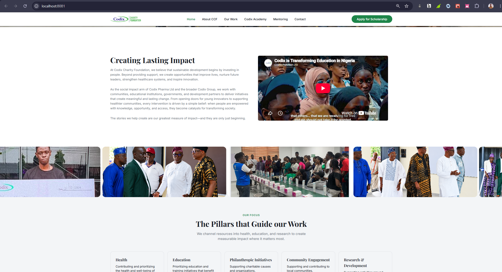
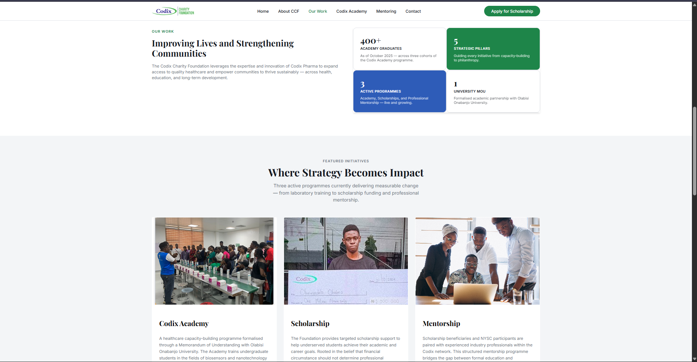
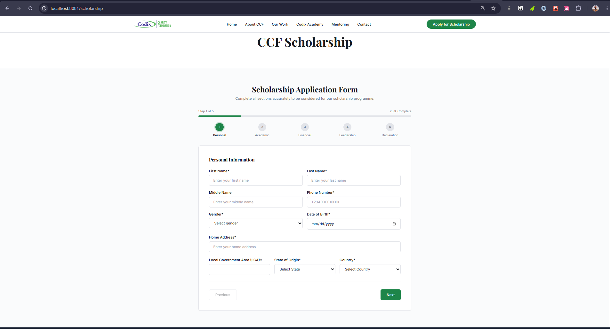
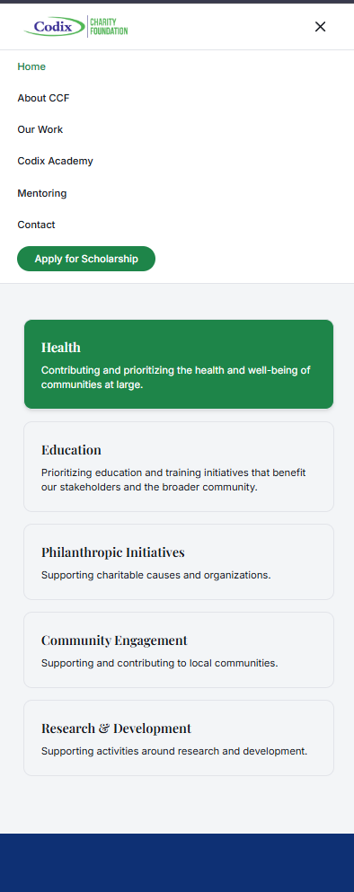
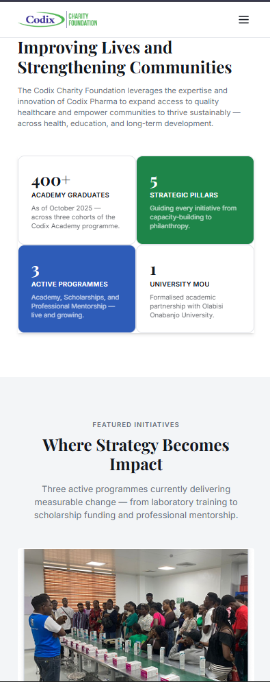

# Codix Charity Foundation



A responsive website for **Codix Charity Foundation**, a non-profit organisation investing in people and communities through education, healthcare, and youth development initiatives across Nigeria.

The platform provides an online presence for the foundation, communicating its mission and initiatives while providing an accessible way for users to engage with the organisation.

**Live Website:** https://codix-charity-six.vercel.app



## Overview

Codix Charity Foundation is committed to creating meaningful impact by supporting individuals and communities through initiatives focused on:

- **Education:** Supporting educational opportunities and empowering the next generation.
- **Healthcare:** Promoting access to healthcare and community well-being.
- **Youth Development:** Investing in young people through empowerment and development initiatives.

The website was designed to communicate the foundation's mission through an engaging, accessible, and responsive digital experience.

## Features

- Responsive website design for desktop and mobile devices.
- Multi-step form with client-side validation.
- Interactive form navigation and input validation.
- Serverless form submission and email delivery.
- Email integration using Resend.
- Automated email delivery with PDF attachment support.
- Page metadata and SEO optimisation.
- Open Graph metadata for social media sharing.
- Smooth page transitions and UI animations.
- Optimised visual assets for improved loading experience.



## My Role and Contributions

I collaborated with a UI/UX designer who defined the website flow and visual direction. My responsibility was translating the designs into a functional and responsive web application.

My contributions included:

- Collaborated with the UI/UX designer to understand and implement the website flow.
- Translated UI/UX designs into a functional, responsive website.
- Implemented a multi-step form with client-side validation to improve the user submission experience.
- Developed serverless functions to handle form submissions.
- Integrated Resend for transactional email delivery.
- Implemented email delivery with PDF attachment support.
- Structured page metadata, SEO descriptions, and Open Graph tags to improve search visibility and social sharing.
- Implemented animations and transitions using Framer Motion and Tailwind CSS.
- Optimised website images and visual assets for improved performance.
- Ensured consistent responsiveness across different screen sizes.

## Mobile Responsiveness





## Technology Stack

| Technology           | Purpose                                 |
| -------------------- | --------------------------------------- |
| React                | Component-based user interface          |
| TypeScript           | Type safety and application development |
| JavaScript ES6       | Application logic                       |
| Vite                 | Development and build tooling           |
| Tailwind CSS         | Styling and responsive layouts          |
| Framer Motion        | Animations and transitions              |
| Serverless Functions | Backend form submission handling        |
| Resend               | Transactional email delivery            |

## Getting Started

### Prerequisites

- Node.js
- npm

### Installation

Clone the repository:

```bash
git clone

cd codix-charity

npm install
```

### Environment Variables

Create a `.env` file in the project root and configure the required environment variables:

```env
RESEND_API_KEY=your_resend_api_key
```

Keep your API keys private and never commit your `.env` file.

### Run Development Server

```bash
npm run dev
```

Open the local URL provided in your terminal.

### Build for Production

```bash
npm run build
```

## Serverless Form Integration

The application uses serverless functions to process form submissions without requiring a dedicated backend server.

Resend handles transactional email delivery, including email notifications and PDF attachments.

The integration provides a way for submitted information to be delivered to the foundation while keeping email credentials on the server side.

## Deployment

The project is deployed on Vercel.

Configure the required environment variables in your Vercel project settings to enable serverless form submissions and email delivery.

## Acknowledgements

- UI/UX design and website flow: UI/UX design collaborator.
- Brand identity, content, and project direction: Codix Charity Foundation.
